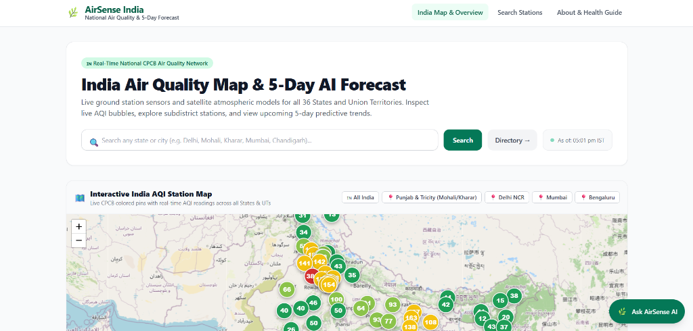
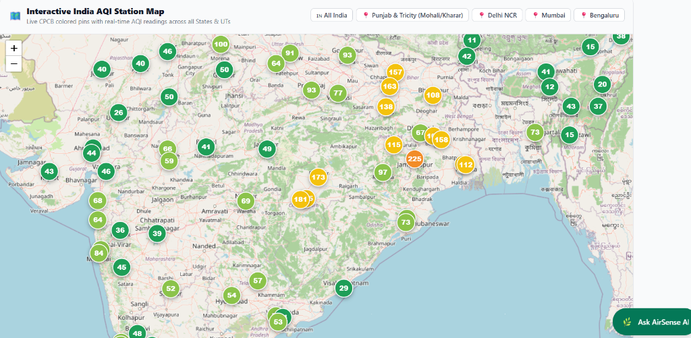
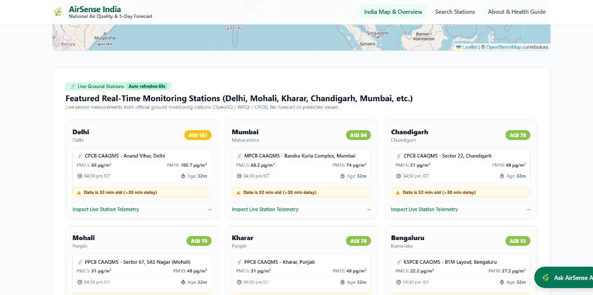
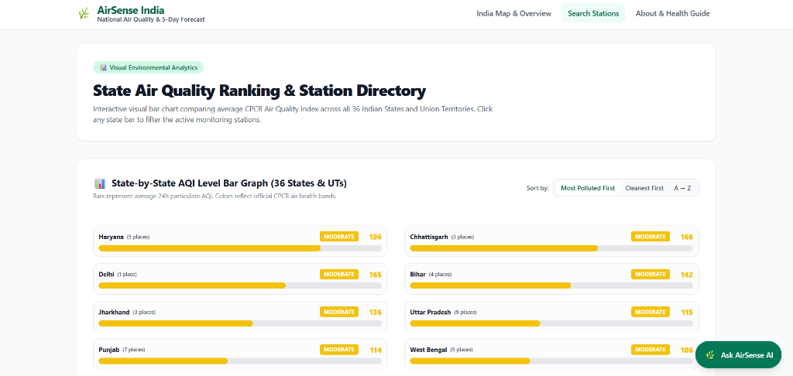
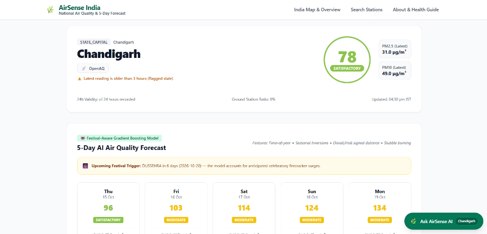
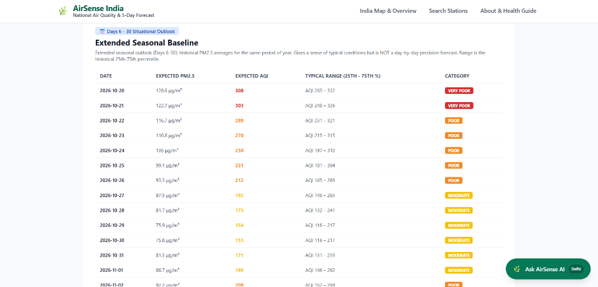
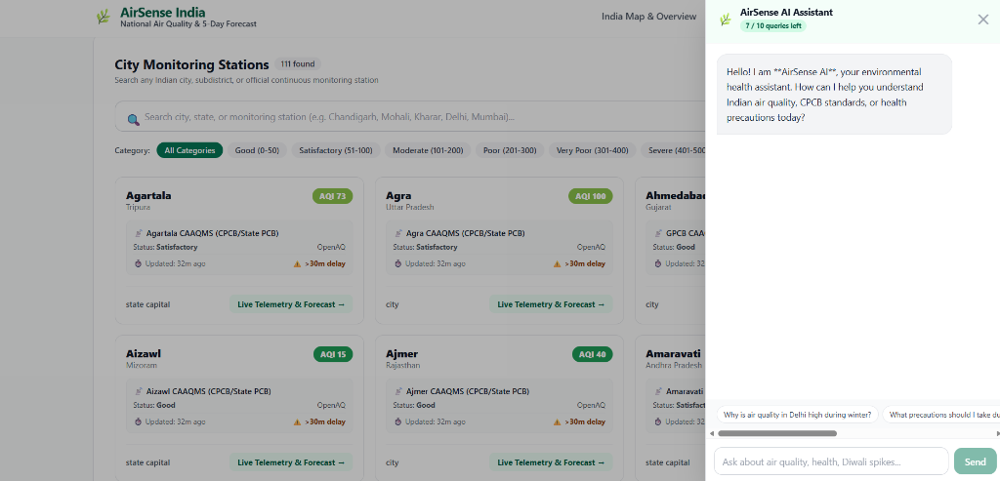

# 🌿 AirSense India

**National Air Quality Monitoring, CPCB Station Telemetry & 5-Day AI Forecast Platform**

AirSense India is a modern, full-stack environmental analytics platform tracking real-time air quality across all **36 States and Union Territories** and **111 major Indian cities**. Built strictly in accordance with **Central Pollution Control Board (CPCB 2014)** standards and **Indian Standard Time (IST, UTC+5:30)**.

---

## 🌟 Key Features

1. **Interactive National AQI Bubble Map**
   - Real-time CPCB color-coded station pins across India.
   - Interactive popups showing live AQI, monitoring station names, status category, and direct links to deep-dive analytics.
   - Quick-zoom region presets: All India, Punjab & Tricity (Mohali/Kharar/Chandigarh), Delhi NCR, Mumbai, and Bengaluru.
   - Zero watermark, 100% free OpenStreetMap standard tiles (no API keys required).

   
   

2. **Real-Time Ground Monitoring Station Telemetry**
   - Strictly measured values from continuous ambient air monitoring stations (CAAQMS) via OpenAQ v3 and WAQI APIs.
   - Displays actual monitoring station name (e.g. *CPCB CAAQMS - Anand Vihar, Delhi*, *Sector 22 Chandigarh*, *Sector 67 Mohali*, *Kharar*).
   - Exact measurement timestamp and real-time **Data Age in minutes**.
   - Automatic 60-second background polling with **Delayed Feed Warning (⚠️ >30 min old)**.
   - Zero synthetic, modeled, or fake AQI values on live dashboards.

   

3. **Advanced Search & Station Directory (`/search`)**
   - Instant search by city name, state, or monitoring station.
   - Visual **State AQI Bar Graph** showing all 36 States/UTs sorted by pollution level at a glance.
   - Filter by CPCB Category (Good, Satisfactory, Moderate, Poor, Very Poor, Severe).
   - Sort by most polluted, cleanest, or alphabetical order.
   - Instant autocomplete suggestions dropdown directly under the home search bar.

   

4. **5-Day Festival-Aware AI Forecast & 30-Day Seasonal Outlook**
   - Gradient Boosting model accounting for seasonal inversions, stubble burning cycles, and celebratory festival surges (Diwali, Holi, Dussehra).
   - Extended situational outlook for Days 6–30 based on day-of-year historical baselines and interquartile confidence ranges.

   
   

5. **About & Environmental Health Guide (`/about`)**
   - Comprehensive breakdown of CPCB health impacts for low, moderate, and high pollution bands.
   - Direct comparison between Indian National Ambient Air Quality Standards (NAAQS) and WHO 2021 guidelines.

6. **AirSense AI Assistant**
   - Built-in conversational assistant answering queries about pollution sources, health advisories, and local air quality.
   - Daily device tracking (10 free queries per session/day via local storage).

   

---

## 🧠 AI Architecture, Forecasting Models & Data Pipeline

AirSense India uses a specialized multi-tiered machine learning and statistical modeling pipeline designed specifically for the Indian atmospheric and cultural calendar:

```
┌────────────────────────────────────────────────────────────────────────────────┐
│                           LIVE DATA PIPELINE                                   │
│  [OpenAQ v3 Ground Stations] ──(failover)──> [WAQI Geo Feed CAAQMS]            │
│                            │                                                   │
│                            ▼                                                   │
│              [Raw PM2.5 / PM10 Sensor Readings]                                │
│                            │                                                   │
│                            ▼                                                   │
│             [CPCB 2014 Linear Breakpoint Engine]                               │
│                            │                                                   │
│                            ▼                                                   │
│                 [Governing Indian AQI Value]                                   │
└────────────────────────────┬───────────────────────────────────────────────────┘
                             │
                             ▼
┌────────────────────────────────────────────────────────────────────────────────┐
│                         AI PREDICTIVE ENGINES                                  │
│                                                                                │
│  1. 5-Day Festival-Aware Model (FestivalModel)                                 │
│     • Architecture: scikit-learn HistGradientBoostingRegressor                 │
│     • Loss Function: Squared error (central) + Quantile loss (80% interval)    │
│     • Target: Log-ratio change vs 3-day rolling mean: ln(y / mean3)            │
│     • Engineered Features:                                                     │
│       - Festival Proximity: Signed day distance to Diwali, Dussehra, Holi      │
│       - Agrarian Stubble Cycle: Oct–Nov residue burning flag (Punjab/Haryana)  │
│       - Meteorology/Inversion: Harmonic day-of-year encoding (sin/cos DOY)     │
│       - Autoregressive Lags: lag0, 3-day, 7-day, 30-day moving averages        │
│                                                                                │
│  2. Days 6–30 Extended Seasonal Baseline (SeasonalOutlook)                     │
│     • Methodology: Circular Day-of-Year window (DOY ± 15 days)                 │
│     • Output: Historical median baseline + 25th-75th Interquartile Range (IQR) │
│                                                                                │
│  3. AirSense Conversational AI Assistant                                       │
│     • Natural Language interface answering air quality & health questions      │
│     • Injects live station telemetry directly into model context               │
│     • Session/device rate limiting: 10 queries per day via localStorage        │
└────────────────────────────────────────────────────────────────────────────────┘
```

### Detailed AI & Data Specifications:

1. **Station Telemetry & Ingestion**:
   - **Ground Sensors (No Forecasts for Live AQI)**: Live data is fetched from official Continuous Ambient Air Quality Monitoring Stations (CAAQMS).
   - **Failover Hierarchy**: Queries **OpenAQ v3** first (`/locations/{id}/latest`). If unavailable, automatically falls back to **WAQI** geo-coordinates (`/feed/geo:{lat};{lon}/`).
   - **Staleness Control**: Every measurement includes an explicit timestamp. Readings older than 30 minutes trigger a `⚠️ >30 min delay` warning. Background polling occurs every 60 seconds.

2. **Official CPCB 2014 AQI Mathematics**:
   The AQI is computed using the piecewise linear interpolation formula:
   $$I = I_{low} + \frac{I_{high} - I_{low}}{C_{high} - C_{low}} \times (C - C_{low})$$
   Sub-indices are computed separately for $PM_{2.5}$ and $PM_{10}$, and the governing AQI is the maximum sub-index: $\text{AQI} = \max(I_{PM2.5}, I_{PM10})$.

3. **Festival & Seasonal Machine Learning (`FestivalModel`)**:
   Standard time-series models (ARIMA/SARIMAX) fail during Indian winters because firecracker combustion during **Diwali** and seasonal **paddy stubble burning** cause non-linear multi-fold spikes. The Gradient Boosting model solves this by learning non-linear relative multiplier effects from historical festival proximity features.

---

## 🚀 Quick Start (Windows)

The repository includes a one-click launcher that starts both the backend and frontend simultaneously:

```cmd
start_local_dev.bat
```

- **Web Dashboard:** [http://localhost:5173](http://localhost:5173)
- **API Documentation (Swagger UI):** [http://localhost:8000/docs](http://localhost:8000/docs)

---

## 🛠️ Manual Installation & Run

### Prerequisites
- **Python 3.10+** (Python 3.12 recommended)
- **Node.js 18+** & **npm**

---

### Step 1: Backend Setup (FastAPI)

```bash
# Navigate to backend directory
cd backend

# Create and activate virtual environment
# On Windows:
python -m venv .venv
.venv\Scripts\activate

# On macOS/Linux:
python3 -m venv .venv
source .venv/bin/activate

# Install dependencies
pip install -r requirements.txt

# Start backend server (defaults to local SQLite database: airq.db)
uvicorn app.main:app --host 0.0.0.0 --port 8000 --reload
```

The API server will run at `http://127.0.0.1:8000`. You can inspect the interactive OpenAPI documentation at `http://127.0.0.1:8000/docs`.

---

### Step 2: Frontend Setup (React + Vite + Tailwind CSS)

Open a new terminal window:

```bash
# Navigate to frontend directory
cd frontend

# Install node dependencies
npm install

# Start Vite development server
npm run dev
```

The frontend will start at `http://localhost:5173`. Requests to `/map`, `/places`, `/about`, and `/agent` are automatically proxied to the backend on port 8000.

---

### Step 3: Production Build (Single-Port Serving)

You can also build the frontend into static assets:

```bash
cd frontend
npm run build
```

When built, the FastAPI backend on port 8000 automatically serves the production frontend at `http://localhost:8000/` without needing Vite running!

---

## ⚙️ Configuration & API Keys (.env)

> [!IMPORTANT]
> **API Key Setup for Live Ground Station Streaming:**
> - To fetch **real-time live station measurements directly from the sensors**, you need a free API key from either **OpenAQ** or **WAQI** (both take 30 seconds to get for free):
>   1. **OpenAQ v3 Key (Preferred)**: Register free at [explore.openaq.org](https://explore.openaq.org) $\rightarrow$ copy your key.
>   2. **WAQI Token (Fallback)**: Enter your email at [aqicn.org/data-platform/token](https://aqicn.org/data-platform/token/) $\rightarrow$ token is sent instantly.
> - Add your key(s) to `backend/.env`:
>   ```ini
>   OPENAQ_API_KEY=your_actual_openaq_api_key_here
>   WAQI_TOKEN=your_actual_waqi_token_here
>   ```
> - **Running Without API Keys (Offline Evaluation Mode):**
>   If you clone and run without adding API keys, the application automatically uses the included pre-seeded SQLite database (`airq.db`). All 111 catalogue cities and official CPCB monitoring stations will still display so you can immediately explore and evaluate the UI, maps, charts, and forecasts!

### Example `backend/.env` Configuration:

```ini
APP_ENV=development
DATABASE_URL=sqlite:///airq.db
AUTO_CREATE_TABLES=true
AUTO_SEED_PLACES=true
ALLOWED_ORIGINS=http://localhost:5173,http://127.0.0.1:5173,http://localhost:8000,http://127.0.0.1:8000

# 📡 Real-Time Ground Monitoring Station APIs (Free Registration):
OPENAQ_API_KEY=               # Free at https://explore.openaq.org
WAQI_TOKEN=                   # Free at https://aqicn.org/data-platform/token/

# 🤖 Optional: AirSense AI Assistant LLM Provider
AGENT_ENABLED=true
LLM_API_KEY=                  # Groq or OpenAI key (optional, has built-in offline fallback)
LLM_MODEL=llama-3.3-70b-versatile
```

---

## 📊 CPCB Air Quality Index Breakpoints

Calculated using the official Indian CPCB 2014 linear interpolation standard for 24-hour PM2.5 and PM10:

| AQI Band | Category | Color | PM2.5 (μg/m³) | PM10 (μg/m³) |
| :---: | :---: | :---: | :---: | :---: |
| **0 – 50** | Good | `#1E9E57` | 0 – 30 | 0 – 50 |
| **51 – 100** | Satisfactory | `#8BC34A` | 31 – 60 | 51 – 100 |
| **101 – 200** | Moderate | `#F4C20D` | 61 – 90 | 101 – 250 |
| **201 – 300** | Poor | `#F28C28` | 91 – 120 | 251 – 350 |
| **301 – 400** | Very Poor | `#D32F2F` | 121 – 250 | 351 – 430 |
| **401 – 500** | Severe | `#7B1113` | 250+ | 430+ |

---

## 📁 Repository Structure

```
air_quality/
├── start_local_dev.bat             # One-click Windows launcher for both servers
├── README.md                       # Project documentation & run guide
│
├── backend/
│   ├── app/
│   │   ├── main.py                 # FastAPI application & SPA mounting
│   │   ├── models.py               # SQLAlchemy schema (Place, Measurement, Forecast)
│   │   ├── routers/
│   │   │   ├── places.py           # Map summary, live station data, 5-day forecast
│   │   │   ├── agent.py            # Natural language assistant endpoint
│   │   │   └── health.py           # Health check (/healthz)
│   │   ├── services/
│   │   │   ├── aqi.py              # Official Indian CPCB AQI calculation engine
│   │   │   ├── live_stations.py    # Station lookup orchestrator (OpenAQ/WAQI)
│   │   │   ├── festival_model.py   # Festival-aware Gradient Boosting forecasting
│   │   │   └── seasonal_outlook.py # Days 6-30 historical median & IQR baseline
│   │   └── data/
│   │       ├── india_places.csv    # 111 catalogue places (All 36 States & UTs)
│   │       └── festivals.py        # Indian festival calendar & date distances
│   ├── airq.db                     # SQLite database with pre-seeded catalogue
│   └── requirements.txt            # Python dependencies
│
└── frontend/
    ├── src/
    │   ├── Home.jsx                # Interactive Map & Overview page
    │   ├── main.jsx                # React Router v7 root configuration
    │   ├── pages/
    │   │   ├── SearchPage.jsx      # Advanced Station Directory with filters
    │   │   ├── PlacePage.jsx       # City details, live dials, 5-day & 30-day forecast
    │   │   └── AboutPage.jsx       # CPCB vs WHO health & air quality guide
    │   └── components/
    │       ├── Header.jsx          # Top navigation bar
    │       ├── IndiaAqiMap.jsx     # Leaflet OpenStreetMap bubble map
    │       └── AiAssistantModal.jsx# Floating AI conversational assistant
    ├── vite.config.js              # Vite server & API proxy rules
    └── package.json                # Frontend dependencies (React 19, Tailwind)
```

---

## 📜 License & Acknowledgments

- **License:** Open Source under the MIT License.
- **Data Attributions:**
  - **CPCB / State Pollution Control Boards:** Official Indian ambient air quality monitoring standards.
  - **OpenAQ v3:** Global open air quality sensor platform.
  - **WAQI (aqicn.org):** World Air Quality Index project.
  - **OpenStreetMap:** Map tiles and geographic data under Open Database License (ODbL).
